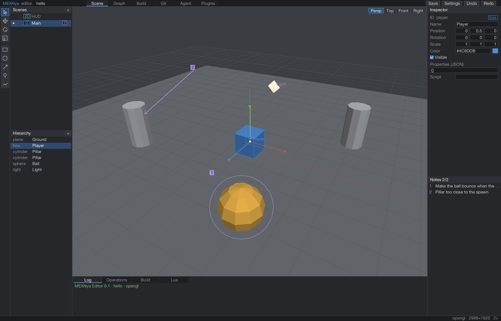
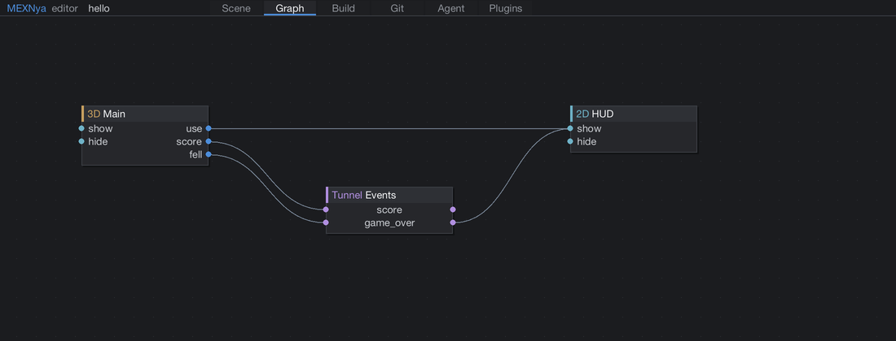
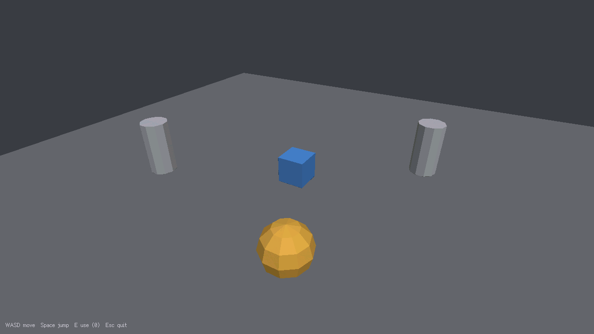

<div align="center">

<table align="center">
<tr><td align="left">

<pre><code>

   ████    ████  ████████ ███   ██  ███▓   ██░
   █████  █████  ██         ██░██   █████  ██░███   ██  █████
   ██▒██  ██▒██  ███████     ███    ███░██ ██░ ██  ██▒ ██   ██
   ██▒ ████ ▒██  ██         █████   ███  ████░  ██ ██  ████▒██
   ██▒ ▒██▒ ▒██  ████████ ███   ██░ ███   ███░  ░███   ██  ███
                                                 ██
                                               ███</code></pre>

</td></tr>
</table>

### A small C engine. An editor for you and your AI agents.

`C99` · `Lua 5.4` · [v0.1.0](mexnya.json) · [GPL-3.0](LICENSE)

**[Get started](#quick-start)** · **[Handbook](docs/guide.md)** · **[Agent workflow](#working-with-agents)** · **[Examples](samples/)**

**English** / [简体中文](README_zhcn.md)

</div>

[](docs/images/editor-scene.png)

<p align="center"><sub>The editor runs on the engine itself. Scene layers, object tools and visual feedback share one workspace.</sub></p>

## Small engine, shared workspace

MEXNya is a desktop game engine written in **plain C99**, with an editor built for
people and AI coding agents to work on the same project. Its central idea is simple:
**point to the change, keep the context**.

Draw a box, circle, arrow or pen stroke on the scene and leave a note. MEXNya saves
the mark, the objects it covers, the world position and a snapshot. An agent can read
that context and edit through the same logged, undoable operation layer used by the UI.

| Build the scene | Connect the game | Share the work |
| :--- | :--- | :--- |
| Stack 3D worlds and 2D UI layers. Use transform gizmos, snapping and a pixel-accurate canvas. | Wire scene ports with **Lines** and **Tunnels**, then simulate how signals travel. | Leave visual notes. Call editor operations from a shell, Lua script or native plugin. |

**Under the hood:** OpenGL 3.3 and software rendering · native and retro display modes ·
semantic input · audio mixing · Lua 5.4 · five interface languages.

<details>
<summary><strong>Explore the Graph page and sample game</strong></summary>

### Wire scenes together



### Start from a playable template



The template includes movement, jumping and a scene connection that shows the HUD.
See [making a game](docs/guide.md#making-a-game) for the code walkthrough.

</details>

## Quick start

You need a **C99 compiler**, **CMake 3.16+**, **Python 3.8+** and **Git**.
Linux also needs the [SDL3 build dependencies](docs/guide.md#requirements).
The first configure fetches a pinned SDL3 release.

```bash
git clone https://github.com/harukrsm/MEXNya.git
cd MEXNya
cmake -S . -B build/debug -DCMAKE_BUILD_TYPE=Debug
cmake --build build/debug -j
```

Open the editor or play the sample:

```bash
bin/mexnya run
./build/debug/samples/hello/hello
```

### Build on macOS from Terminal

The macOS build needs only Apple's command line tools. CMake fetches and builds the
pinned SDL3 during the first configure.

```bash
xcode-select --install                                    # once: clang, make, macOS SDK
git clone https://github.com/harukrsm/MEXNya.git
cd MEXNya
cmake -S . -B build/debug -DCMAKE_BUILD_TYPE=Debug
cmake --build build/debug -j"$(sysctl -n hw.ncpu)"
```

Then run the checks, the editor and the sample game:

```bash
bash scripts/test.sh
bin/mexnya run
./build/debug/samples/hello/hello
```

The first configure downloads SDL3 and takes a few minutes; later builds reuse
`build/debug`. For a release build:

```bash
cmake -S . -B build/release -DCMAKE_BUILD_TYPE=Release
cmake --build build/release -j"$(sysctl -n hw.ncpu)"
./build/release/samples/hello/hello
```

CMake presets cover the same configurations with CMake 3.23 or newer:
`cmake --preset dev` and `cmake --build --preset dev` (or `release`).

The same source builds for Intel and Apple Silicon; CMake targets the host
architecture. If the machine cannot reach the network, pass an SDL3 source tree with
`-DMEXNYA_SDL3_DIR=/path/to/SDL`.

On Windows, use `bin\mexnya.cmd run` and the sample's `.exe` path for your CMake
generator. See [platform status](#project-status) for what has been tested.

<details>
<summary><strong>Use an existing SDL3 checkout or build offline</strong></summary>

Pass `-DMEXNYA_SDL3_DIR=/path/to/SDL` to CMake, place SDL3 sources in
`third_party/SDL3/`, or install SDL3 where `find_package(SDL3)` can find it.
See the [build reference](docs/guide.md#build-tool-and-mexnyajson) for all options.

</details>

### Make your first game

Add this repository's `bin/` directory to your `PATH`, then:

```bash
mexnya new ~/games/my-game
cd ~/games/my-game
mexnya build
./build/debug/my-game
mexnya run
```

The generated project includes a working C entry point, editable scenes and an asset
folder. **WASD** moves the player, **Space** jumps, and **E** fires a port to show the HUD.

## Working with agents

**Mark → read → edit → review.** Notes carry the visual context; operations carry the changes.
The editor generates `mexnya/AGENTS.md` inside each project to explain the interface.

From your game directory, an agent can inspect notes and make an edit:

```bash
mexnya agent note.list '{"status":"open"}' --as my-agent

mexnya agent object.set '{"id":"player","fields":{"color":"#8DDBC2"}}' --as my-agent

mexnya agent view.snapshot '{"scene":"main","preset":"top"}' --as my-agent
```

With the editor open, changes appear live. With it closed, the same operations run
headless on the project files. Requests are recorded in `mexnya/agent/log.jsonl`.

**[Agent bridge and operation reference →](docs/guide.md#working-with-ai-agents)**

## Find your way around

| I want to… | Start here |
| :--- | :--- |
| Learn the editor and its shortcuts | [Editor guide](docs/guide.md#the-editor) |
| Understand Scenes, Ports, Lines and Tunnels | [Core concepts](docs/guide.md#concepts) |
| Write a game in C | [Game walkthrough](docs/guide.md#making-a-game) · [Engine API](docs/guide.md#engine-api) |
| Automate edits or connect an agent | [Operations](docs/guide.md#all-operations) |
| Extend the editor | [Lua and native plugins](docs/guide.md#plugin-specification) |
| Configure builds or inspect project data | [Build tool](docs/guide.md#build-tool-and-mexnyajson) · [File formats](docs/guide.md#file-formats) |
| Translate the interface or explore the source | [Localization](docs/guide.md#localization) · [Repository layout](docs/guide.md#repository-layout) |

## Project status

**0.1.0 · Early development.** The repository documents the following validation status:

| Platform | Current status |
| :--- | :--- |
| **macOS** | Engine, editor, sample and tests exercised during development. |
| **Windows x64** | Cross-compiles with MinGW-w64; runtime testing on Windows is still pending. |
| **Linux x64** | Backend present; author build and runtime validation are still pending. |

Physics, skeletal animation import, an in-editor model editor, and mobile / web targets
are outside the current release. See [platform details](docs/guide.md#platform-status).

## Contributing

[Issues](https://github.com/harukrsm/MEXNya/issues) and
[pull requests](https://github.com/harukrsm/MEXNya/pulls) are welcome.
Keep the C99 dependency boundaries, add interface strings in all five languages,
and run the existing checks after a debug build:

```bash
bash scripts/test.sh
```

Read the [contribution notes](docs/guide.md#contributing) before changing project formats.

## License

MEXNya is licensed under [GNU GPL v3.0](LICENSE). The engine's GPL terms also apply
to distributed games that link it. Bundled libraries and fonts retain their own
licenses; see [third-party notices](THIRD_PARTY.md).
