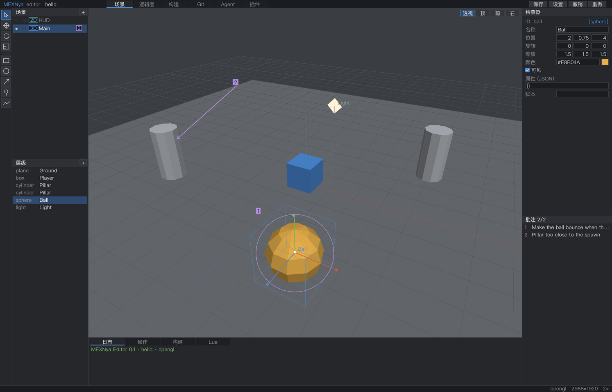
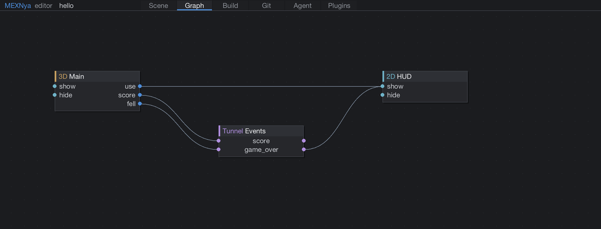
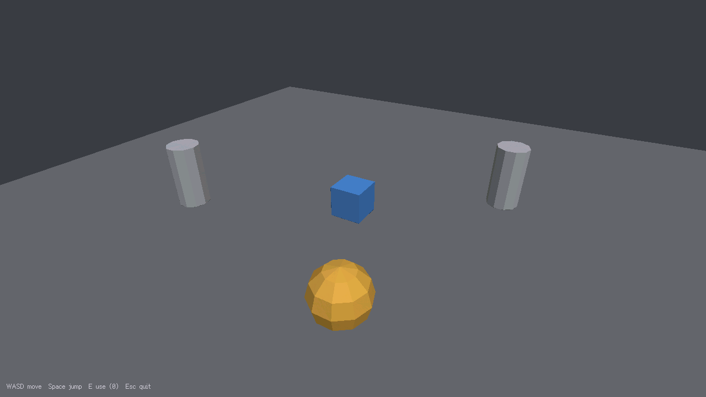

<div align="center">

<table align="center">
<tr><td align="left">

<pre><code>

   ████    ████  ████████ ███   ██  ███▓   ██░
   █████  █████  ██         ██░██   █████  ██░███   ██  █████
   ██▒██  ██▒██  ███████     ███    ███░██ ██░ ██  ██▒ ██   ██
   ██▒ ████ ▒██  ██         █████   ███  ████░  ██ ██  ████▒██
   ██▒ ▒██▒ ▒██  ████████ ███   ██░ ███   ███░  ░███   ██  ███
                                                 ██
                                               ███</code></pre>

</td></tr>
</table>

### 小巧的 C 引擎，与你和 AI Agent 一起工作的编辑器。

`C99` · `Lua 5.4` · [v0.1.0](mexnya.json) · [GPL-3.0](LICENSE)

**[快速开始](#快速开始)** · **[完整手册（英文）](docs/guide.md)** · **[Agent 协作](#与-agent-协作)** · **[示例项目](samples/)**

[English](README.md) / **简体中文**

</div>

[](docs/images/editor-scene_zh.png)

<p align="center"><sub>编辑器由引擎自身构建。场景、对象工具和可视化反馈，都在同一个工作区里。</sub></p>

## 小引擎，共同创作的工作区

MEXNya 是一个使用 **纯 C99** 编写的桌面游戏引擎，配套编辑器让人与 AI 编程 Agent
可以操作同一个项目。它的核心想法是：**直接指出要改哪里，同时保留现场信息。**

在场景中画框、圆、箭头或自由笔迹，再写下批注。编辑器会保存标记、覆盖的对象、
对应的世界坐标和截图。Agent 读取这些信息后，通过与界面相同的操作层修改项目；
项目编辑可以撤销，也有日志可查。

| 搭建场景 | 连接游戏逻辑 | 一起编辑 |
| :--- | :--- | :--- |
| 叠放 3D 世界与 2D 界面图层，使用变换工具、吸附和像素级画布。 | 用 **Line（连线）** 和 **Tunnel（通道）** 连接场景端口，模拟信号传播。 | 留下可视化批注，通过命令行、Lua 脚本或原生插件调用编辑器操作。 |

**引擎能力：** OpenGL 3.3 与软件渲染 · 原生与复古显示模式 · 语义化输入 ·
音频混音 · Lua 5.4 · 五种界面语言。

<details>
<summary><strong>展开查看 Graph 页面与示例游戏</strong></summary>

### 连接场景



### 从可玩的模板开始



模板已包含移动、跳跃，以及通过场景连线显示 HUD 的示例。
代码说明见[游戏开发指南（英文）](docs/guide.md#making-a-game)。

</details>

## 快速开始

准备 **C99 编译器**、**CMake 3.16+**、**Python 3.8+** 和 **Git**。
Linux 还需要 [SDL3 构建依赖](docs/guide.md#requirements)。首次配置会下载固定版本的 SDL3。

```bash
git clone https://github.com/harukrsm/MEXNya.git
cd MEXNya
cmake -S . -B build/debug -DCMAKE_BUILD_TYPE=Debug
cmake --build build/debug -j
```

打开编辑器，或运行示例游戏：

```bash
bin/mexnya run
./build/debug/samples/hello/hello
```

### 在 macOS 的终端中构建

macOS 只需要 Apple 的命令行工具；首次配置时 CMake 会下载并编译固定版本的 SDL3。

```bash
xcode-select --install                                    # 只需一次：clang、make、macOS SDK
git clone https://github.com/harukrsm/MEXNya.git
cd MEXNya
cmake -S . -B build/debug -DCMAKE_BUILD_TYPE=Debug
cmake --build build/debug -j"$(sysctl -n hw.ncpu)"
```

随后运行检查、编辑器和示例游戏：

```bash
bash scripts/test.sh
bin/mexnya run
./build/debug/samples/hello/hello
```

首次配置会下载 SDL3，需要几分钟；之后的构建复用 `build/debug`。发布版构建：

```bash
cmake -S . -B build/release -DCMAKE_BUILD_TYPE=Release
cmake --build build/release -j"$(sysctl -n hw.ncpu)"
./build/release/samples/hello/hello
```

CMake 3.23 及以上也可以用预设：`cmake --preset dev`、`cmake --build --preset dev`
（或 `release`）。

同一份源码可在 Intel 与 Apple Silicon 上构建，CMake 使用本机架构。若机器无法联网，
可用 `-DMEXNYA_SDL3_DIR=/path/to/SDL` 指向本地的 SDL3 源码。

### 打包 macOS 应用

```bash
bash scripts/package_macos.sh
open dist/MEXNya.app
```

脚本会构建 Release，生成 `dist/MEXNya.app` 与 `dist/hello.app`，并进行 ad-hoc 签名。
分发时把 `MEXNYA_CODESIGN_ID` 设为 Developer ID；公证未自动化。

Windows 使用 `bin\mexnya.cmd run`；示例的 `.exe` 路径取决于所用的 CMake 生成器。
各平台的验证情况见[项目状态](#项目状态)。

<details>
<summary><strong>使用本地 SDL3，或离线构建</strong></summary>

向 CMake 传入 `-DMEXNYA_SDL3_DIR=/path/to/SDL`，将 SDL3 源码放到
`third_party/SDL3/`，或把 SDL3 安装到 `find_package(SDL3)` 可以找到的位置。
完整选项见[构建工具参考](docs/guide.md#build-tool-and-mexnyajson)。

</details>

### 创建第一个游戏

先把本仓库的 `bin/` 目录加入 `PATH`，然后运行：

```bash
mexnya new ~/games/my-game
cd ~/games/my-game
mexnya build
./build/debug/my-game
mexnya run
```

生成的项目包含 C 入口、可编辑场景和资源目录。**WASD** 移动，**空格** 跳跃，
**E** 触发端口并显示 HUD。

## 与 Agent 协作

**标记 → 读取 → 编辑 → 检查。** 批注提供现场信息，操作接口负责执行修改。
编辑器会在每个项目中生成 `mexnya/AGENTS.md`，说明 Agent 可以怎样使用这些接口。

Agent 在游戏目录中可以这样读取批注、修改对象并截图：

```bash
mexnya agent note.list '{"status":"open"}' --as my-agent
mexnya agent object.set '{"id":"player","fields":{"color":"#8DDBC2"}}' --as my-agent
mexnya agent view.snapshot '{"scene":"main","preset":"top"}' --as my-agent
```

编辑器打开时，修改会实时显示；关闭时，相同操作以无界面模式处理项目文件。
请求记录在 `mexnya/agent/log.jsonl` 中。

**[Agent 桥接与完整操作参考（英文）→](docs/guide.md#working-with-ai-agents)**

## 文档导航

以下详细手册目前为英文。

| 想做什么 | 从这里开始 |
| :--- | :--- |
| 熟悉编辑器与快捷键 | [编辑器指南](docs/guide.md#the-editor) |
| 理解 Scene、Port、Line 和 Tunnel | [核心概念](docs/guide.md#concepts) |
| 用 C 编写游戏 | [游戏开发指南](docs/guide.md#making-a-game) · [引擎 API](docs/guide.md#engine-api) |
| 自动化编辑或接入 Agent | [操作列表](docs/guide.md#all-operations) |
| 扩展编辑器 | [Lua 与原生插件](docs/guide.md#plugin-specification) |
| 配置构建或查看项目数据 | [构建工具](docs/guide.md#build-tool-and-mexnyajson) · [文件格式](docs/guide.md#file-formats) |
| 翻译界面或阅读源码 | [本地化](docs/guide.md#localization) · [仓库结构](docs/guide.md#repository-layout) |

## 项目状态

**0.1.0 · 早期开发阶段。** 仓库记录的平台验证情况如下：

| 平台 | 当前状态 |
| :--- | :--- |
| **macOS** | 开发期间已验证引擎、编辑器、示例与测试。 |
| **Windows x64** | 可通过 MinGW-w64 交叉编译；仍待 Windows 实机运行验证。 |
| **Linux x64** | 已有后端代码；仍待作者完成构建与运行验证。 |

当前版本尚不包含物理系统、骨骼动画导入、内置模型编辑器，以及移动端 / Web 目标。
更多说明见[平台详情](docs/guide.md#platform-status)。

## 参与贡献

欢迎提交 [Issue](https://github.com/harukrsm/MEXNya/issues) 或
[Pull Request](https://github.com/harukrsm/MEXNya/pulls)。请保持 C99 与模块依赖边界，
为界面文字补齐五种语言，并在 Debug 构建后运行现有检查：

```bash
bash scripts/test.sh
```

修改项目格式前，请阅读[贡献说明](docs/guide.md#contributing)。

## 许可证

MEXNya 使用 [GNU GPL v3.0](LICENSE)。链接本引擎并分发的游戏也受相应 GPL 条款约束。
随附库与字体保留各自的许可证，详见[第三方声明](THIRD_PARTY.md)。
